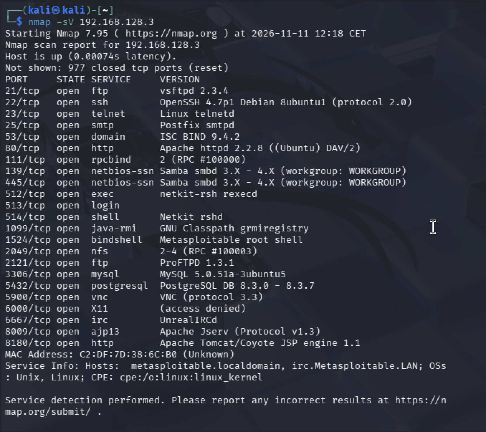

## Objective

Identify the open services on a target machine and detect vulnerabilities based on their versions.

## Environment and tools

- Lab: the isolated lab described in [Virtual lab setup](../virtual-lab-setup/)
- Attacker: Kali Linux with Nmap 7.95
- Target: Metasploitable 2 - `192.168.128.3`

## Method

1. Run a service and version detection scan on the target:
   `nmap -sV 192.168.128.3`
   The `-sV` option asks Nmap to detect the service and the version running on each open port.
2. Search for public vulnerabilities and backdoors based on the detected versions.
3. Prioritise the findings by risk, starting with the ones that give direct access to the system.

## Results

The scan found **23 open TCP ports**, covering file sharing, remote access, web, database and network services.

Main findings:

| Port | Service | Risk |
|------|---------|------|
| 1524 | Metasploitable root shell (bindshell) | **Critical**: direct root access without a password |
| 21 | vsftpd 2.3.4 | **Critical**: this version contains a known backdoor that opens a shell on port 6200 |
| 23, 512-514 | Telnet, rexec, rlogin, rsh | **High**: everything is sent in plain text, including passwords |

The backdoor on port 1524 is the most serious issue because anyone who can reach the machine gets full administrator control.

## What I would do differently

On any machine I manage, I will make sure to open only the necessary ports, to reduce the attack surface. To fix the issues found here, I would:

- stop the bindshell service on port 1524;
- update vsftpd to a version without the backdoor;

Next time, I would also scan all 65,535 ports with `nmap -p-`, because a default scan only checks the 1,000 most common ports.