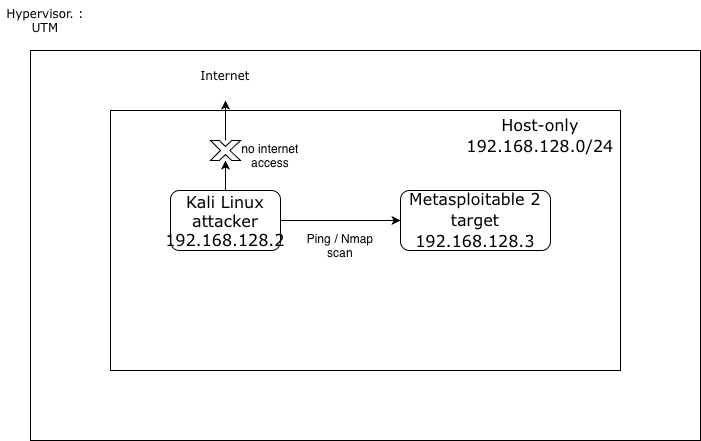
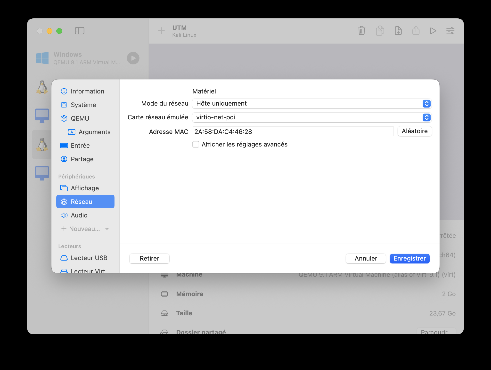
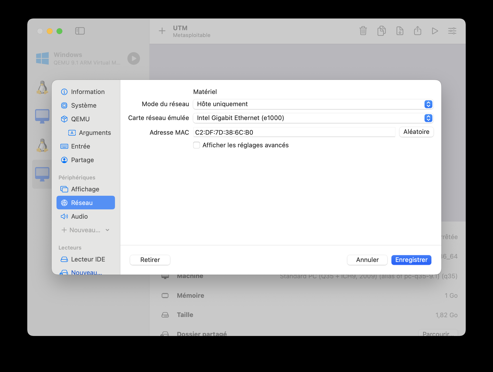
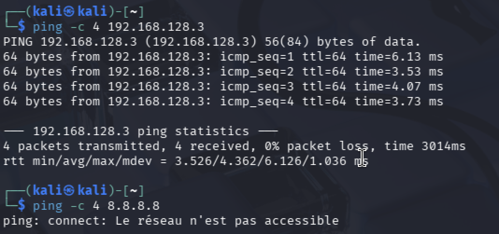

# Virtual Lab Setup

## Objective

Build an isolated virtual lab in order to practise offensive security techniques safely, without any risk to real systems or networks.

## Environment and tools

| Component | Details |
|-----------|---------|
| Host | Mac with Apple M1 chip |
| Hypervisor | UTM (VirtualBox cannot run x86 virtual machines on Apple Silicon) |
| Attacker | Kali Linux (ARM version) - `192.168.128.2` |
| Target | Metasploitable 2, emulated as x86_64 - `192.168.128.3` |
| Network | Host-only network `192.168.128.0/24`, isolated from the Internet |

## Method

1. Download and install UTM.
2. Create the Kali Linux virtual machine (ARM, virtualised).
3. Create the Metasploitable 2 virtual machine (x86_64, emulated).
4. Configure both virtual machines on the same host-only network.
5. Test the communication between the two machines from Kali:
   `ping 192.168.128.3`
6. Test the isolation of the lab by trying to reach the Internet:
   `ping 8.8.8.8`

## Results

- Kali reached Metasploitable with 0% packet loss: the two machines can communicate.
- `ping 8.8.8.8` failed with "network unreachable": the lab cannot access the Internet.

## What I would do differently

Metasploitable 2 did not boot at first: UTM enables UEFI boot by default for new virtual machines, but Metasploitable 2 is an old system that only supports legacy BIOS boot. I fixed it by disabling UEFI boot in the virtual machine's settings. Next time, I would check the boot mode before the first start, as soon as I create a virtual machine for an older operating system.